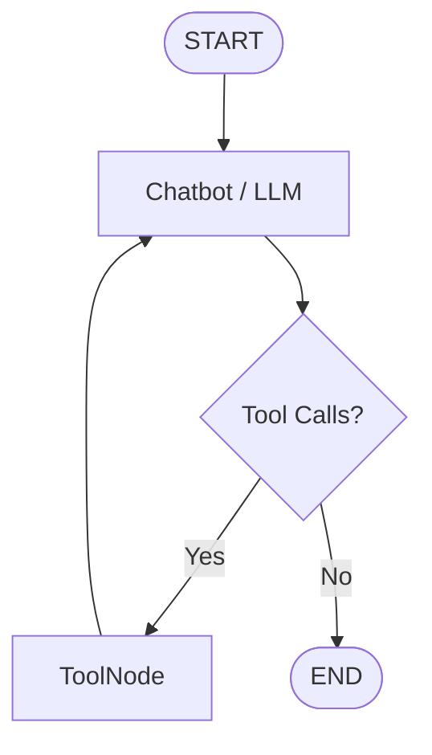

# LangGraph Tool-Calling Agent

A tool-using AI agent built with **LangGraph**, **LangChain**, and **OpenAI GPT-4o-mini**. The project explores graph-based agent orchestration, tool calling, conversational memory, and state management.

## Features

- **Wikipedia Search** — retrieves information from Wikipedia using a LangChain tool.
- **Historical Events** — uses an LLM to provide notable historical events for a given date.
- **Palindrome Checker** — checks whether a word or phrase is a palindrome, ignoring spaces, punctuation, and letter case.
- **Tool Calling** — allows the LLM to select and invoke tools based on the user's request.
- **Conversational Memory** — preserves conversation history across turns using LangGraph's `MemorySaver` checkpointer.
- **Interactive CLI** — supports continuous conversations directly in the terminal.
- **Execution Tracing** — displays tool calls, arguments, tool results, and assistant responses.

## Architecture

The agent is implemented as a directed graph using LangGraph.



### Execution Flow

1. The user submits a message through the terminal.
2. The chatbot node sends the conversation history to GPT-4o-mini.
3. The model decides whether to respond directly or request a tool.
4. LangGraph routes tool requests to `ToolNode`, which executes the selected tool.
5. The tool result is added to the conversation history.
6. The chatbot receives the result and generates a response.
7. If no further tool call is needed, the graph terminates.

### Memory

The project uses LangGraph's `MemorySaver` to checkpoint conversation state.

A configurable `thread_id` identifies a conversation, allowing subsequent messages in the same thread to reference earlier exchanges.

**Note:** `MemorySaver` stores state in memory and does not persist it across application restarts.

## Tech Stack

- Python
- LangGraph
- LangChain
- OpenAI GPT-4o-mini
- Wikipedia API integration
- Python-dotenv

## Getting Started

### Prerequisites

- Python 3.10+
- An OpenAI API key

### 1. Clone the repository

```bash
git clone https://github.com/YOUR_USERNAME/langgraph-tool-calling-agent.git
cd langgraph-tool-calling-agent
```

### 2. Create a virtual environment

```bash
python3 -m venv .venv
```

Activate it on macOS or Linux:

```bash
source .venv/bin/activate
```

### 3. Install dependencies

```bash
python -m pip install -r requirements.txt
```

### 4. Configure environment variables

Create a `.env` file in the project root:

```env
OPENAI_API_KEY=your_openai_api_key
```

Never commit your `.env` file or expose your API key.

### 5. Run the agent

```bash
python main.py
```

Enter a message in the terminal to start a conversation. Type `exit` or `quit` to stop the application.

## Example Interactions

```text
You: Who was Cristiano Ronaldo?
🔧 Using tool: wikipedia
🔎 Query: {'query': 'Cristiano Ronaldo'}
📄 Tool result: ...

🤖 Assistant: Cristiano Ronaldo is a Portuguese professional footballer...

You: Is "racecar" a palindrome?
🔧 Using tool: palindrome_checker

🤖 Assistant: The phrase or word racecar is a palindrome.

You: What happened on July 20, 1969?
🔧 Using tool: historical_events

🤖 Assistant: On July 20, 1969, Apollo 11 landed on the Moon...
```

*Example output is illustrative; actual responses and tool selection depend on the model.*

## Key Learning Outcomes

- Building graph-based workflows for LLM applications.
- Integrating custom and third-party tools.
- Understanding model-driven tool selection and execution.
- Managing conversational state with checkpoints.
- Tracing agent execution and debugging tool interactions.
- Connecting LLMs with external information sources.

## Future Improvements

- Add persistent checkpoint storage.
- Improve tool descriptions and routing reliability.
- Add automated tests for custom tools.
- Introduce structured logging and error handling.
- Add a web-based chat interface.

## License

Add a license if you intend to distribute or reuse this project publicly.
